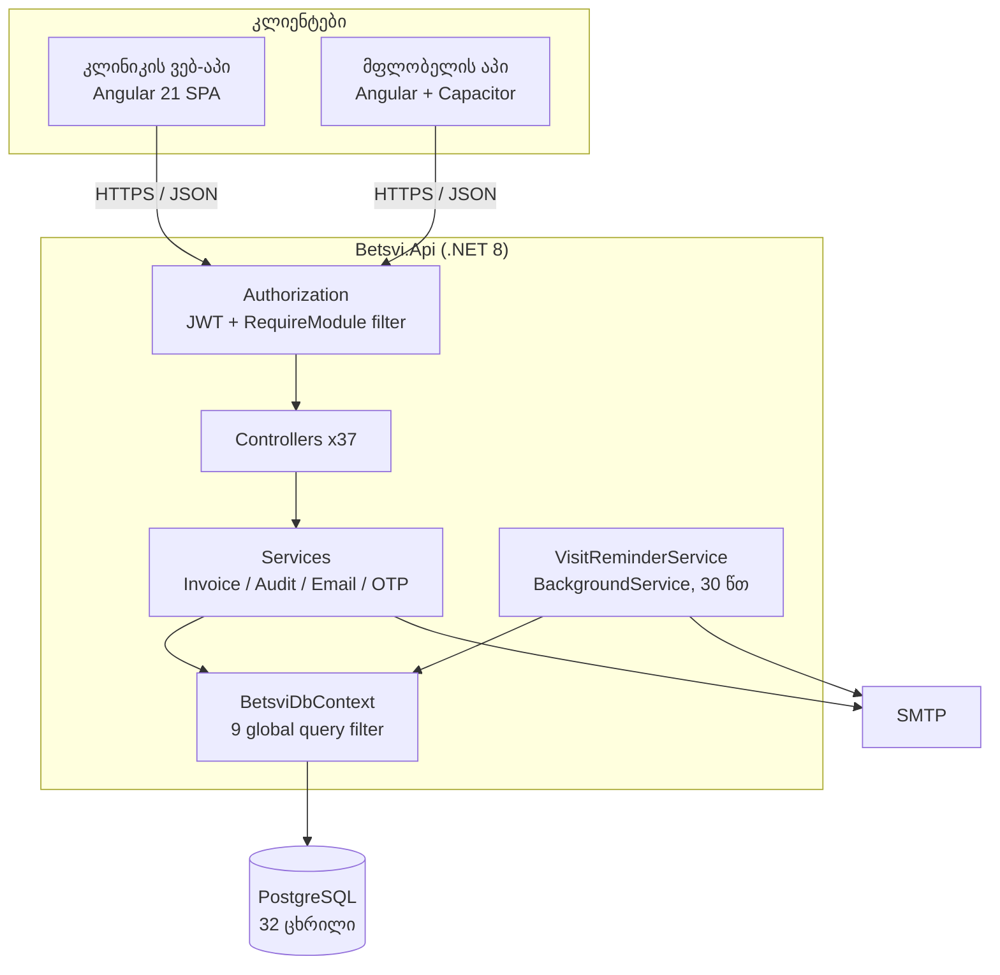
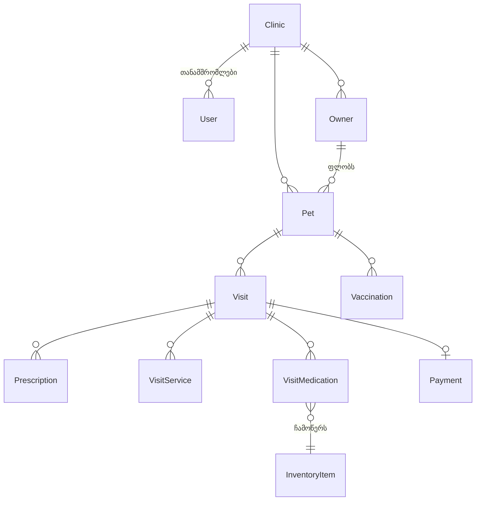

# ბეწვი - არქიტექტურა

ვარიანტი **D** - საკუთარი იდეა. ვეტერინარული კლინიკების მართვის SaaS.
მასშტაბი: 37 API კონტროლერი, 32 ცხრილი, ორი კლიენტი.

---

## 1. არქიტექტურული სტილი

**მოდულური მონოლითი + SPA კლიენტი** (client-server, ფენოვანი).

ერთი დეპლოიდი .NET 8 API, რომელსაც ორი Angular აპი ელაპარაკება HTTP/JSON-ით.
შიგნით ფენებად დაყოფილია: Controllers -> Services -> EF Core -> PostgreSQL.

### რატომ არა მიკროსერვისები

**1. ტრანზაქციული მთლიანობა.** ერთი ვიზიტის დახურვა ერთდროულად წერს ვიზიტს,
ჩამოწერს მედიკამენტს საწყობიდან და ქმნის ანგარიშის პოზიციებს. მონოლითში ეს ერთი
ტრანზაქციაა. მიკროსერვისებში იგივე მოითხოვს saga-ს და კომპენსაციურ ოპერაციებს,
ანუ მნიშვნელოვნად მეტ კოდს ზუსტად იმ ადგილას, სადაც შეცდომა ფულს ეხება.

**2. ტენანტის იზოლაცია ერთ ადგილას.** კლინიკების გამიჯვნა ხდება EF Core-ის 9
global query filter-ით `BetsviDbContext`-ში. ეს ერთი ფაილია, რომელსაც ყველა
კითხვა გაივლის. სერვისებად დაშლისას იგივე წესი 37-ჯერ უნდა გამეორდეს და
თითოეული გამეორება ახალი შესაძლებლობაა, რომ ერთმა კლინიკამ სხვისი პაციენტი
დაინახოს.

**3. გუნდის ზომა.** პროექტს ერთი დეველოპერი ჰყავს და ჯერ არც ერთი გადამხდელი
კლინიკა. მიკროსერვისები ხსნის გუნდების დამოუკიდებლად დეპლოის პრობლემას. ეს
პრობლემა აქ არ არსებობს, სამაგიეროდ ემატება CI/CD, მონიტორინგისა და ქსელური
გამართვის ხარჯი.

> **მოდულური** ნიშნავს, რომ დაშლის საზღვრები უკვე გავლებულია: ყოველ ფუნქციურ
> ბლოკს (ლაბორატორია, საწყობი, ფინანსები) აქვს საკუთარი კონტროლერები და
> ჩართვა-გათიშვა ხდება `[RequireModule("lab")]` ატრიბუტით. როცა რომელიმე მოდულს
> ცალკე მასშტაბირება დასჭირდება, გატანა შესაძლებელია ლოგიკის გადაწერის გარეშე.

---

## 2. კომპონენტების დიაგრამა



**მოთხოვნის გზა:** JWT მოწმდება, `TenantContext` ამოიღებს `ClinicId`-ს
claim-იდან, `RequireModule` ამოწმებს ჩართული აქვს თუ არა კლინიკას ეს მოდული,
შემდეგ კონტროლერი და სერვისი, ბოლოს DbContext, სადაც global query filter
ავტომატურად ზღუდავს კითხვას ამ კლინიკით.

---

## 3. Design Pattern-ები

### Backend: Filter / Decorator

`RequireModuleAttribute : IAsyncActionFilter` ამოწმებს, ჩართული აქვს თუ არა
კლინიკას მოდული, სანამ action გაეშვება.

```csharp
[RequireModule("lab")]
public class LabController : ControllerBase { ... }
```

პატერნი აქ იმიტომაა არჩეული, რომ წესი **ჯვარედინია**: ის ერთნაირად ეხება
ლაბორატორიის, საწყობისა და ფინანსების ათეულობით endpoint-ს. ყოველ მეთოდში
`if`-ის ჩაწერა ნიშნავდა იმავე ლოგიკის გამეორებას და პირველივე დავიწყებული
შემოწმება იქნებოდა გათიშული მოდულის ღია კარი.

**თანმხლები:** Repository + Unit of Work (EF Core-ის `DbSet` და `SaveChanges`),
Ambient Context (`ITenantContext`, რომელიც DbContext-შია შეყვანილი).

### Frontend: Proxy + stale-while-revalidate

`CacheService` დგას კომპონენტსა და HTTP-ს შორის და გამჭვირვალედ ანაცვლებს
ქსელურ გამოძახებას.

- პირველი გამომწერი: მოთხოვნა იგზავნება და პასუხი ჩაიწერება
- TTL-ის ფარგლებში: ქეშიდან მყისიერად, HTTP-ის გარეშე
- TTL-ის შემდეგ: ჯერ ძველი მნიშვნელობა (ინტერფეისი არ ცარიელდება), ფონზე კი
  ახალი მოდის და იმავე `ReplaySubject`-ში ჩაედინება

ეს ვეტკლინიკის რეალურ სცენარზეა მორგებული: ექიმი დღეში ათჯერ ხსნის ერთსა და
იმავე პაციენტს და ყოველ ჯერზე თეთრი ეკრანის ცდა მიუღებელია.

**თანმხლები:** HTTP Interceptor (`jwt-interceptor` ამატებს token-ს),
Guard / Chain of Responsibility (`auth.guard`, `module.guard`,
`superadmin.guard`), Store + Observer (Angular signals).

---

## 4. API - 5 endpoint

| # | მეთოდი და მისამართი | დანიშნულება | წვდომა |
|---|---|---|---|
| 1 | `GET /api/visits?date=2026-10-18` | დღის განრიგი | კლინიკის თანამშრომელი |
| 2 | `POST /api/visits` | ახალი ვიზიტის რეგისტრაცია | ექიმი, რეგისტრატურა |
| 3 | `PATCH /api/visits/{id}/status` | სტატუსი: დაგეგმილი -> დასრულებული | ექიმი |
| 4 | `GET /api/pets/search?q=რექსი` | ძებნა სახელით, ტელეფონით, ჩიპით | კლინიკის თანამშრომელი |
| 5 | `GET /api/pets/public/{qrToken}` | მფლობელის წვდომა QR-ით | **ანონიმური**, token-ით |

მე-5 განზრახ გამოირჩევა: ერთადერთი endpoint-ია, რომელიც JWT-ს არ ითხოვს.
წვდომას განსაზღვრავს ერთჯერადი `qrToken` და ის მხოლოდ ერთ პაციენტს ხსნის,
შიდა სამედიცინო შენიშვნების გარეშე.

**პასუხის ნიმუში (endpoint 4):**

```json
[
  {
    "id": 41,<br/>    "name": "რექსი",<br/>    "species": "ძაღლი",<br/>    "breed": "German Shepherd",<br/>    "microchip": "9410000131676",<br/>    "ownerName": "ზურაბ მაისურაძე",<br/>    "ownerPhone": "+995558778899",<br/>    "lastVisit": "2026-08-08"
  }
]
```

---

## 5. ბაზა

**PostgreSQL** (რელაციური), EF Core Code-First მიგრაციებით, 32 ცხრილი.

### რატომ SQL და არა NoSQL

1. **ტრანზაქცია.** ვიზიტის დახურვა ერთდროულად ცვლის ვიზიტს, საწყობის ნაშთსა და
   ანგარიშს. ან სამივე უნდა ჩაიწეროს, ან არცერთი.
2. **მთლიანობა.** სამედიცინო ჩანაწერი მფლობელის გარეშე ან ანგარიში არარსებული
   სერვისით დაუშვებელია. უცხო გასაღები ამას ბაზის დონეზე კრძალავს.
3. **ანგარიშგება.** სტატისტიკის გვერდი ითვლის შემოსავალს პერიოდზე, ტოპ
   დიაგნოზებს და ვიზიტების განაწილებას. ეს ყველაფერი `JOIN` და `GROUP BY`-ია.



**ტენანტობა:** `Clinic`, `Owner`, `Pet`, `Visit`, `InventoryItem` და სხვა
ცხრილებს აქვთ `ClinicId`, რომელზეც 9 global query filter მუშაობს. აპლიკაციის
კოდში `WHERE ClinicId = ...` არსად იწერება, ფილტრი ავტომატურად ემატება.

---

## 6. ტექნოლოგიური სტეკი

| ფენა | ტექნოლოგია |
|---|---|
| კლინიკის აპი | Angular 21, standalone components, signals, Tailwind |
| მფლობელის აპი | Angular + Capacitor 8 (iOS / Android) |
| API | .NET 8, ASP.NET Core Web API |
| ORM | EF Core, Code-First მიგრაციები |
| ბაზა | PostgreSQL (Neon) |
| ავთენტიკაცია | JWT, როლები და უფლებები claim-ებში |
| ჰოსტინგი | Vercel (front), Railway (API) |
| ტესტები | xUnit + WebApplicationFactory, Vitest |

### რისკები

**1. ტენანტობა ერთ მექანიზმზე დგას.** კლინიკების გამიჯვნას უზრუნველყოფს 9
global query filter. ახალი ცხრილის დამატება ფილტრის გარეშე ნიშნავს, რომ ერთი
კლინიკა სხვისი მონაცემების დანახვას შეძლებს, და ეს არსად "გატყდება", უბრალოდ
ჩუმად გაჟონავს.
*შერბილება:* ინტეგრაციული ტესტები, რომლებიც ყოველ endpoint-ს სხვისი კლინიკის
ჩანაწერზე ამოწმებენ.

**2. უფასო ჰოსტინგის ზღვრები.** Neon და Railway უფასო გეგმებზეა. ცივი გაშვება
და კავშირების ლიმიტი მისაღებია დემოსთვის, მაგრამ არა კლინიკისთვის, რომელსაც
10:00 საათზე პაციენტი დგას.
*შერბილება:* პირველივე გადამხდელ კლინიკამდე ფასიან გეგმაზე გადასვლა.

**3. ერთი დეველოპერი.** 37 კონტროლერი და 32 ცხრილი ერთ ადამიანზეა.
ავადმყოფობა ან საგამოცდო სესია ნიშნავს, რომ განვითარება ჩერდება, ხოლო კლინიკამ
შენზე უკვე გადაიტანა პაციენტების ბაზა.
*შერბილება:* მონაცემების სრული ექსპორტი ნებისმიერ მომენტში, ანუ კლინიკა
ჩაკეტილი არაა. ეს უკვე გაკეთებულია და სწორედ ამიტომ.
