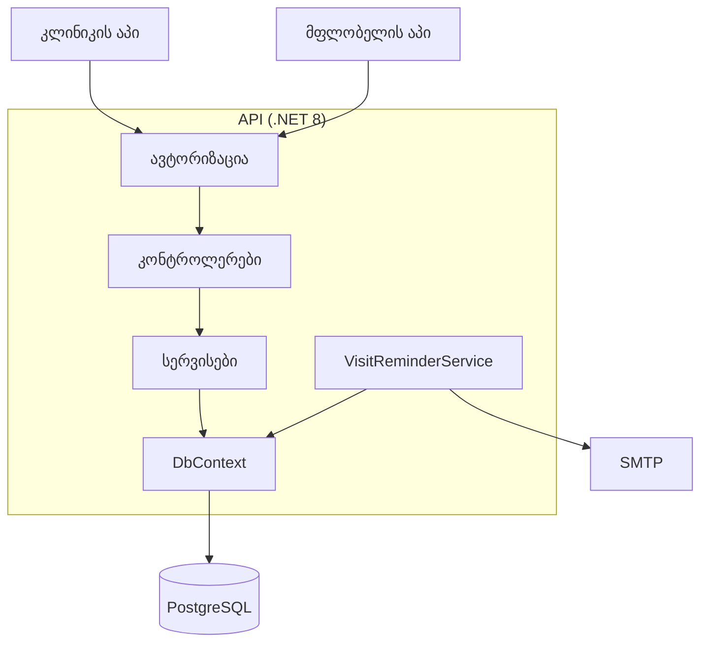
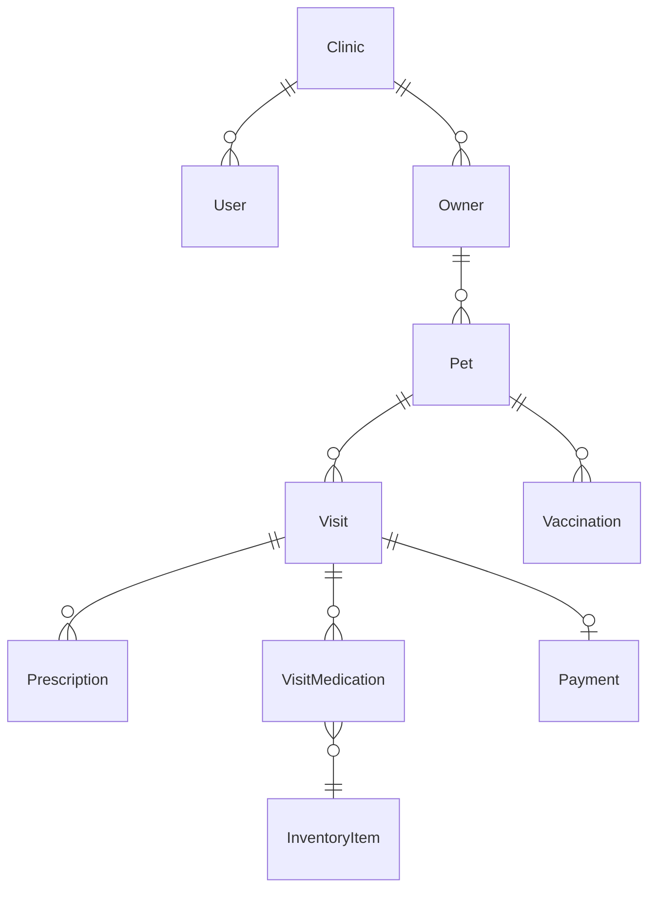

# ბეწვი - არქიტექტურა

პრაქტიკული 2, ვარიანტი D. ვეტკლინიკების მართვის სისტემა, მულტი-ტენანტი SaaS.

---

## 1. სტილი: მოდულური მონოლითი + SPA

ერთი .NET 8 API, Angular კლიენტი, REST.

1. **ოპერაციული სიმარტივე.** პრობლემას ერთ სისტემაში ვეძებ და არა რვა სერვისს შორის.
2. **ტრანზაქციული მთლიანობა.** ვიზიტის დახურვა ერთდროულად წერს ოთხ ცხრილში: ვიზიტი, დანიშნულება, საწყობი, ანგარიში. მონოლითში ეს ერთი ACID ტრანზაქციაა. გაყოფისას საჭირო იქნებოდა saga და კომპენსაციური ოპერაციები, იქ სადაც ფული და მედიკამენტია.
3. **ტენანტის იზოლაცია ერთ ადგილას.** 9 global query filter ერთ ფაილში. მიკროსერვისებში იგივე წესი ყოველ სერვისში მეორდება.

---

## 2. კომპონენტები



**მოთხოვნის გზა:** JWT → `TenantContext` იღებს `ClinicId`-ს → `RequireModule` ამოწმებს მოდულს → კონტროლერი → სერვისი → `DbContext` ფილტრავს კლინიკით.

ისრები ცალმხრივია. `VisitReminderService` ერთადერთია, რომელიც HTTP-ს გარეშე მუშაობს: ყოველ 30 წუთში თვითონ ამოწმებს ბაზას (polling) და ელფოსტას აგზავნის.

---

## 3. Design Pattern-ები

**Backend: Filter / Decorator** - `RequireModuleAttribute : IAsyncActionFilter`

```csharp
[RequireModule("lab")]
public class LabController : ControllerBase { }
```

ამოწმებს მოდულს ყველა endpoint-ზე, კონტროლერის კოდის შეცვლის გარეშე. ასეთ წესს cross-cutting concern ჰქვია.

**Frontend: Proxy + stale-while-revalidate** - `CacheService`

დგას კომპონენტსა და HTTP-ს შორის. ჯერ ქეშიდან აჩვენებს, ფონში ანახლებს. ექიმი ცარიელ ეკრანს არ ხედავს.

---

## 4. API

სცენარი: ვიზიტის ჩაწერიდან დასრულებამდე.

| # | მეთოდი და მისამართი | ნაბიჯი |
|---|---|---|
| 1 | `GET /api/pets/search?q=` | პაციენტს ეძებს |
| 2 | `POST /api/visits` | ვიზიტს წერს |
| 3 | `GET /api/visits/{id}` | ექიმი ხსნის |
| 4 | `POST /api/prescriptions` | დანიშნულებას ამატებს |
| 5 | `PATCH /api/visits/{id}/status` | ხურავს |

`PATCH` და არა `PUT`, რადგან მხოლოდ ერთი ველი იცვლება. `ClinicId` URL-ში არ იგზავნება, token-იდან იკითხება.

---

## 5. ბაზა: PostgreSQL

1. **ტრანზაქცია** - ოთხი ცხრილი ერთად, ან არცერთი
2. **ანგარიშგება** - შემოსავალი და ტოპ დიაგნოზები `JOIN` + `GROUP BY`
3. **მთლიანობა** - უცხო გასაღები კრძალავს ჩანაწერს პაციენტის გარეშე



`VisitMedication` არის წერტილი, სადაც სამედიცინო ჩანაწერი და საწყობი ხვდება.

**მულტი-ტენანტობა:** ერთი ბაზა, `ClinicId` მთავარ ცხრილებზე, 9 global query filter. შვილობილი ცხრილები მშობლის გავლით იფილტრება.

---

## 6. სტეკი და რისკები

Angular 21 · Capacitor · .NET 8 · EF Core · PostgreSQL (Neon) · JWT · Vercel + Railway · xUnit, Vitest

**რისკი 1: ტენანტის გაჟონვა.** ახალ ცხრილს ფილტრი თუ დაავიწყდა, კლინიკა სხვისას დაინახავს. ჩუმად ხდება: არც ჩავარდება, არც ლოგში ჩაიწერება.
→ tenant isolation ტესტები ყოველ endpoint-ზე.

**რისკი 2: მიგრაციის blast radius.** ერთი ბაზაა ყველასთვის. წარუმატებელი მიგრაცია ყველა კლინიკას ერთდროულად აგდებს.
→ backup, staging-ზე წინასწარი გაშვება, rollback. Backup, რომელიც არასდროს აღგიდგენია, backup არ არის.

---

### შესავსები

- [ ] მესამე რისკი, თუ საჭიროა (ერთი დეველოპერი)
- [ ] ვერსიები გადავამოწმო `package.json` / `.csproj`
